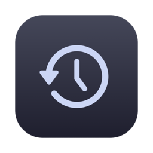
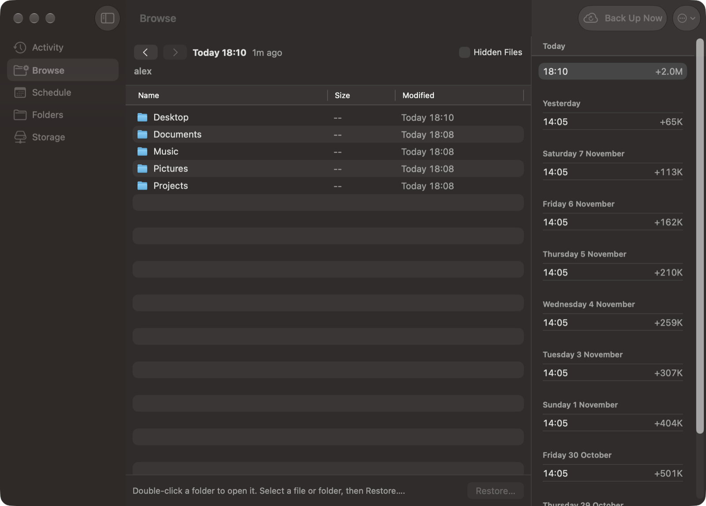
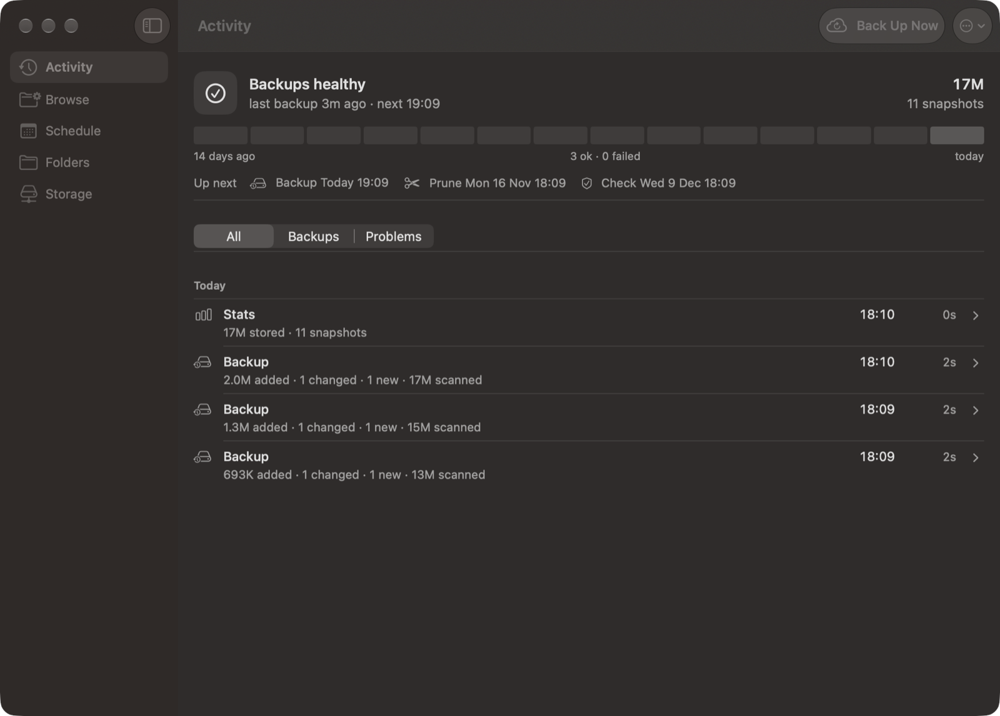
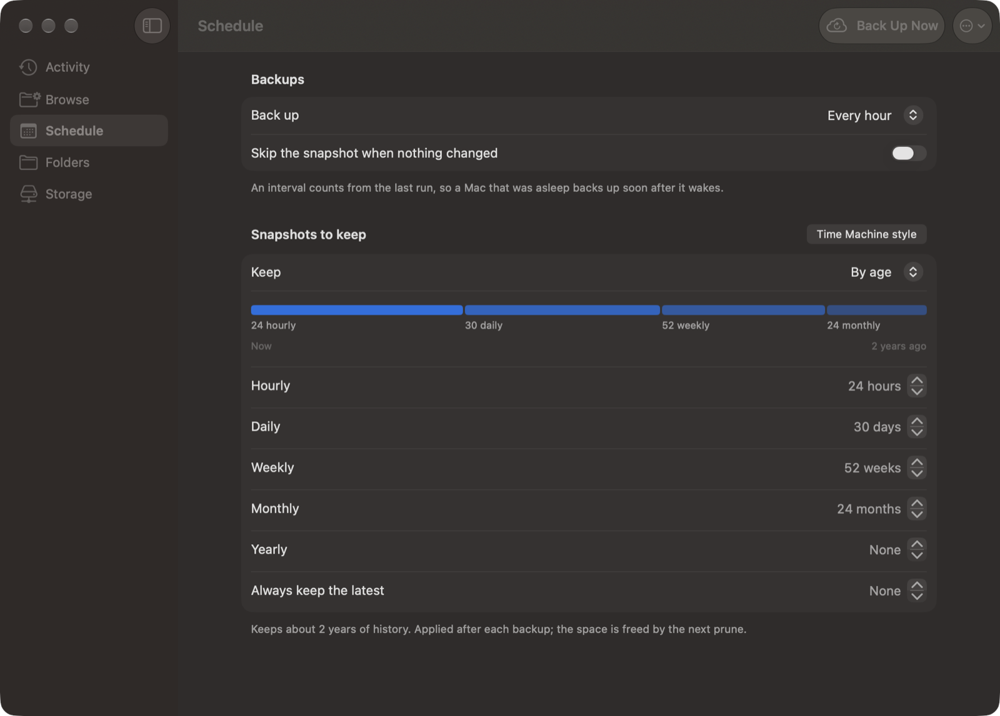
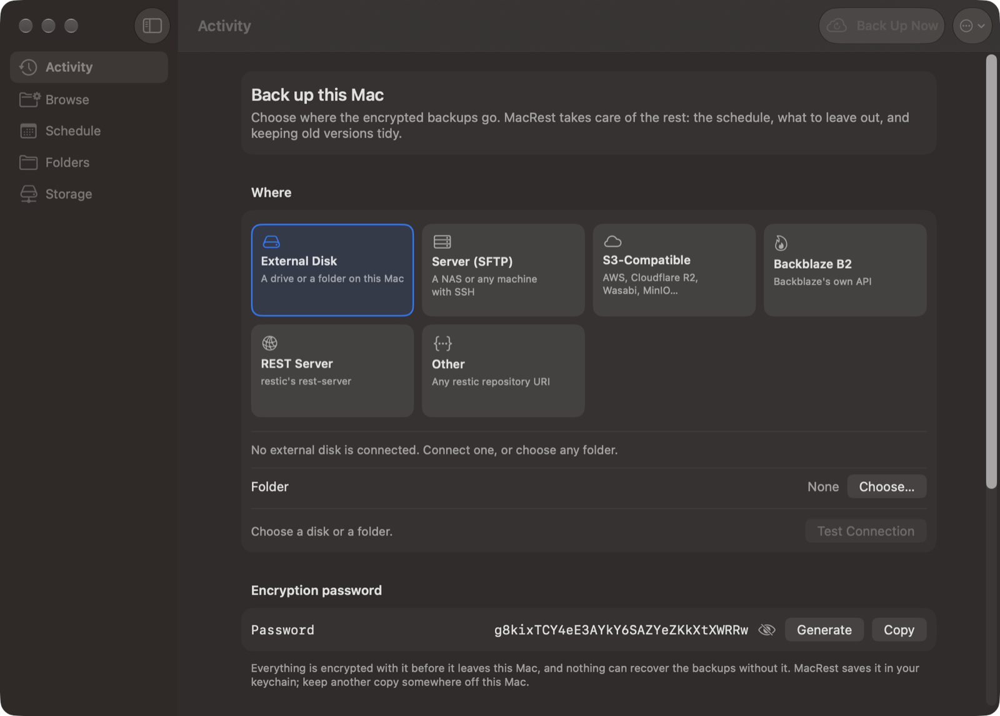
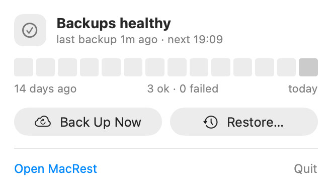

<div align="center">



# MacRest

**A Time Machine alternative for your Mac, built on restic.**
Encrypted, deduplicated backups to a disk, your own server or the cloud, with a native app to watch them and get files back.

[](https://github.com/nchourrout/macrest/actions/workflows/ci.yml)
[](https://github.com/nchourrout/macrest/releases)
[](LICENSE)




</div>

## Why

Time Machine is easy, but it wants a disk or a NAS it can mount, it stores backups in a format only macOS reads, and it can't send them to the cloud. [restic](https://restic.net) solves all of that (encryption before anything leaves the Mac, deduplication, any storage) but it's a command-line tool. [Backrest](https://github.com/garethgeorge/backrest) schedules restic and gives it a web UI.

MacRest is the Mac app on top: install it, choose where the backups go, and you're done. It downloads and runs Backrest for you, sets up the backup in one screen, and replaces the web UI with native windows and a menu bar icon.

## Features

- **One-screen setup.** Pick an external disk, an SFTP server or NAS, S3-compatible storage (AWS, Cloudflare R2, Wasabi, MinIO…), Backblaze B2, a restic REST server, or any restic repository. MacRest tests the connection, finds existing backups to continue, and generates the encryption password (also saved to your keychain).
- **Browse and restore, Time Machine style.** Open any snapshot and move through the timeline while staying in the same folder. Restores always land in a new folder beside the original, so nothing is overwritten.
- **Sensible defaults.** Your home folder, minus caches, VMs, build output and app data that rebuilds itself. Hourly snapshots, kept hourly for a day, daily for a month, weekly for a year and monthly for two years.
- **Health at a glance.** The menu bar icon and the Activity view show the last backup, the next one, two weeks of results, and maintenance (retention, prune, integrity checks) that fails quietly while backups still succeed.
- **Stale locks handled.** A lock left behind by a crashed run blocks cleanup until someone removes it. MacRest spots it, offers Unlock, and can clear stale locks automatically.
- **Storage credentials done right.** Keys go into restic's environment, never into the repository URL, and they can be rotated later without setting anything up again. For SFTP, MacRest can make a dedicated SSH key and install it with `ssh-copy-id`, so your server password is never typed into the app.
- **Native.** SwiftUI, light and dark mode, an optional menu bar icon. No Electron, no browser tab.

## Screenshots

| Activity | Schedule and retention |
|---|---|
|  |  |

| Setup | Menu bar |
|---|---|
|  |  |

## MacRest compared with Time Machine

| | Time Machine | MacRest |
|---|---|---|
| Destinations | Local disk, SMB share | Disk, SFTP, S3-compatible, B2, REST server, anything restic supports |
| Encryption | Optional | Always, before data leaves the Mac |
| Deduplication | Per file | Per chunk, across files and snapshots |
| Off-site to the cloud | No | Yes |
| Readable without a Mac | No | Yes, with restic on Linux, Windows or macOS |
| Restore the whole Mac | Yes (Migration Assistant) | No: files and folders, on top of a fresh macOS |
| Retention | Fixed | Hourly, daily, weekly, monthly and yearly counts you choose |
| Browse from Finder | Yes | Not yet: browse in the app |

MacRest backs up your home folder, not the system: on a new Mac you reinstall your apps, then restore your files.

## Install

1. Download `MacRest-<version>.dmg` from the [latest release](https://github.com/nchourrout/macrest/releases/latest), open it, and drag MacRest to Applications.
2. The app is not notarized yet, so the first launch needs one approval: open it, then click **Open Anyway** in **System Settings > Privacy & Security** (or run `xattr -dr com.apple.quarantine /Applications/MacRest.app`).
3. Open MacRest. It downloads Backrest (a pinned release, checked against its published checksum), starts it in the background, and shows the setup.
4. To include Mail, Messages and Safari, grant **Full Disk Access** to `~/.local/share/backrest/restic` in System Settings > Privacy & Security. macOS grants it per program, and restic is the one that reads your files.

Requires macOS 26 or later. Releases are built for Apple silicon.

### Already using Backrest?

MacRest works with an existing Backrest on port 9898, Homebrew's or your own. It offers **Take Over** to run it itself on the same configuration and history: repositories, snapshots and settings carry over untouched.

## How it works

```
MacRest (SwiftUI) ──HTTP, localhost only──▶ Backrest (scheduler) ──▶ restic ──▶ your storage
```

- **Backrest** runs as a per-user background service, listens on `127.0.0.1:9898` only, and keeps its usual folders: `~/.config/backrest` and `~/.local/share/backrest`.
- **MacRest** is a client of Backrest's API, the one its web UI uses, which still works at http://localhost:9898 if you want it.
- **Your backups are plain restic repositories.** If MacRest disappeared tomorrow, `restic -r <repository> restore` still gets everything back.

## Build from source

The Command Line Tools are enough; Xcode is not required.

```bash
git clone https://github.com/nchourrout/macrest.git && cd macrest
swift test
./build-app.sh ~/Applications/MacRest.app
```

See [`AGENTS.md`](AGENTS.md) for the design notes and the reasoning behind each choice.

## Credits

MacRest stands on [restic](https://github.com/restic/restic) and [Backrest](https://github.com/garethgeorge/backrest), which do the real work. MacRest downloads Backrest's official releases and does not redistribute it.

## License

[MIT](LICENSE)
